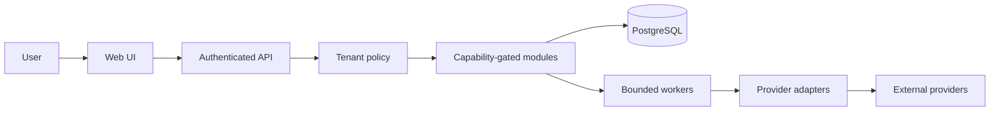

# Architecture (initial decision)

## Boundaries

1. **Web client:** Next.js App Router/React; UI never treats hidden controls as authorization.
2. **API/control plane:** NestJS modular monolith; authenticates users, resolves tenant context server-side, authorizes every read/write, and emits structured outcomes.
3. **Data plane:** separate, consent-gated mailbox content modules and sync workers; no panel credential implies message access.
4. **Provider plane:** external systems of record. Adapters declare per-resource capability and reason; unsupported actions fail explicitly.
5. **Persistence/work:** PostgreSQL as transactional source of truth; Redis/BullMQ or equivalent for bounded durable work with idempotency, leases and per-tenant concurrency. Selection awaits implementation/benchmark evidence.

The first increment does not implement API authentication, persistence, workers, or providers. The dashboard is clearly synthetic. API health confirms process availability only.

## Intended trust flow

Provider reads, sends, mailbox content, secrets and DNS mutation remain out of the first prototype. See `docs/SECURITY_THREAT_MODEL.md` before expanding these boundaries.
