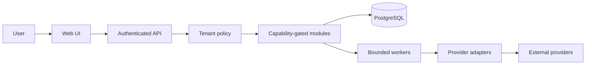

# Architecture (initial decision)

## Boundaries

1. **Web client:** Next.js App Router/React; UI never treats hidden controls as authorization.
2. **API/control plane:** NestJS modular monolith; authenticates users, resolves tenant context server-side, authorizes every read/write, and emits structured outcomes.
3. **Data plane:** separate, consent-gated mailbox content modules and sync workers; no panel credential implies message access.
4. **Provider plane:** external systems of record. Adapters declare per-resource capability and reason; unsupported actions fail explicitly.
5. **Persistence/work:** PostgreSQL as transactional source of truth; Redis/BullMQ or equivalent for bounded durable work with idempotency, leases and per-tenant concurrency. Selection awaits implementation/benchmark evidence.

The first increment implements a PostgreSQL control-plane schema and checksummed migration runner, but the runtime API does not yet persist application data or authenticate users. No workers or providers are connected. The dashboard is clearly synthetic. API health confirms process availability only.

## OAuth and browser trust direction

Because VSN will handle sensitive email data, use a server-side Backend for Frontend (BFF) as the default OAuth connection architecture: Authorization Code + PKCE, provider tokens kept on the server, and an application session cookie for browser calls. Any BFF proxy path must map to explicit provider hosts and allowed methods. User-configured IMAP/SMTP hosts require a separate constrained connector network path and SSRF defenses. This is an architecture direction from RFC 10017, not implemented authentication. Keep provider OAuth consent distinct from VSN user identity and tenant membership.

## Intended trust flow

Provider reads, sends, mailbox content, secrets and DNS mutation remain out of the first prototype. See `docs/SECURITY_THREAT_MODEL.md` before expanding these boundaries.
