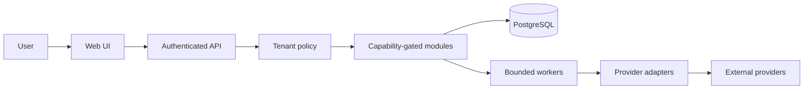

# Architecture (initial decision)

## Boundaries

1. **Web client:** Next.js App Router/React; UI never treats hidden controls as authorization.
2. **API/control plane:** NestJS modular monolith; authenticates users, resolves tenant context server-side, authorizes every read/write, and emits structured outcomes.
3. **Data plane:** separate, consent-gated mailbox content modules and sync workers; no panel credential implies message access.
4. **Provider plane:** external systems of record. Adapters declare per-resource capability and reason; unsupported actions fail explicitly.
5. **Persistence/work:** PostgreSQL is the transactional source of truth. The first job primitive uses tenant-scoped PostgreSQL rows claimed with `FOR UPDATE SKIP LOCKED`, fencing generations and a transactional event outbox. This is a queue-of-record prototype, not yet a production worker or a proven high-throughput substitute for Redis/BullMQ; a broker decision awaits measured throughput/recovery evidence.

The first increments implement a PostgreSQL control-plane schema and checksummed migration runner, plus reusable tenant-scoped job/outbox lease primitives. The runtime API does not yet persist application data or authenticate users. No polling worker, broker publisher, scheduler or providers are connected. The dashboard is clearly synthetic. API health confirms process availability only.

## Durable job and outbox contract (prototype)

- Every job is organization-scoped and deduplicated by `(organization_id, idempotency_key)`; mailbox jobs also carry provider-connection and mailbox keys. The payload is represented only by an optional opaque reference; message bodies and credentials do not belong in queue rows.
- A worker must present an organization ID to claim work. PostgreSQL row locks plus a partial unique mailbox index serialize active work for the same tenant/connection/mailbox. A monotonically increasing lease generation fences stale heartbeat/completion acknowledgements.
- Expired read-only/internal jobs can be reclaimed within the bounded attempt budget. If an external mutation had crossed the persisted dispatch boundary, lease expiry moves it to `unknown`; another mutation for that mailbox is held until an operator/reconciler confirms applied or confirmed-not-applied. A timeout after a provider request can never be proved safe by a database lease alone.
- The queued event is inserted in the same transaction as its job. Outbox delivery is at-least-once: a publisher crash after downstream delivery but before acknowledgement can redeliver, so consumers must deduplicate. No publisher or broker is implemented yet.
- This prototype is not a general-purpose reliable queue guarantee: throughput, lock contention, multi-worker concurrency under PostgreSQL, dead-letter operations, observability, provider-specific reconciliation and process recovery have not been load/chaos tested.

## OAuth and browser trust direction

Because VSN will handle sensitive email data, use a server-side Backend for Frontend (BFF) as the default OAuth connection architecture: Authorization Code + PKCE, provider tokens kept on the server, and an application session cookie for browser calls. Any BFF proxy path must map to explicit provider hosts and allowed methods. User-configured IMAP/SMTP hosts require a separate constrained connector network path and SSRF defenses. This is an architecture direction from RFC 10017, not implemented authentication. Keep provider OAuth consent distinct from VSN user identity and tenant membership.

## Intended trust flow

Provider reads, sends, mailbox content, secrets and DNS mutation remain out of the first prototype. See `docs/SECURITY_THREAT_MODEL.md` before expanding these boundaries.
